# Comparaciones de rendimiento entre técnicas

## Datos Pequeños

Se realizaron 5 corridas y se sacó el promedio de estas.

## Tiempo de ejecución

### Predicciones de precios actuales en base a datos históricos actuales

| Empresa          | Técnica                | Duración   |
|------------------|------------------------|------------|
| Apple            | Fuerza Bruta           | 3.3831     |
|                  | Optimización Bayesiana | 7.9235     |
|                  | Algoritmo Genético     | 18.693     |

| Empresa          | Técnica                | Duración   |
|------------------|------------------------|------------|
| Cisco            | Fuerza Bruta           | 2.7240     |
|                  | Optimización Bayesiana | 3.8928     |
|                  | Algoritmo Genético     | 19.357     |

| Empresa          | Técnica                | Duración   |
|------------------|------------------------|------------|
| Microsoft        | Fuerza Bruta           | 3.7698     |
|                  | Optimización Bayesiana | 7.0763     |
|                  | Algoritmo Genético     | 19.112     |

| Empresa          | Técnica                | Duración   |
|------------------|------------------------|------------|
| Nvidia           | Fuerza Bruta           | 3.1424     |
|                  | Optimización Bayesiana | 6.0530     |
|                  | Algoritmo Genético     | 17.938     |

**Análisis**

Para datos pequeños, en todos los casos la técnica de fuerza bruta es la más rápida, con tiempos de ejecución entre aproximadamente 2.7 y 3.8 segundos para las diferentes empresas. Esto se debe a que esta técnica evalúa todas las posibles soluciones de forma exhaustiva pero sin un proceso de búsqueda inteligente o aleatorio, por lo que, aunque limitada en eficiencia, es simple y rápida para problemas de este tamaño.

La optimización bayesiana toma más tiempo que la fuerza bruta, pero es más rápida que el algoritmo genético, con tiempos de entre 3.8 y 7.9 segundos. La optimización bayesiana utiliza un enfoque probabilístico que permite evaluar menos configuraciones con mayor precisión, el cual requiere más cálculos y tiempo que la fuerza bruta.

El algoritmo genético es la técnica con mayor duración, con tiempos entre 17.9 y 19.3 segundos para las empresas. Esto se debe al enfoque evolutivo que implica múltiples generaciones y evaluaciones de individuos en cada iteración. El proceso de selección, cruce y mutación es computacionalmente intensivo y, como resultado, esta técnica tiende a consumir más tiempo, especialmente en problemas con múltiples parámetros a optimizar.

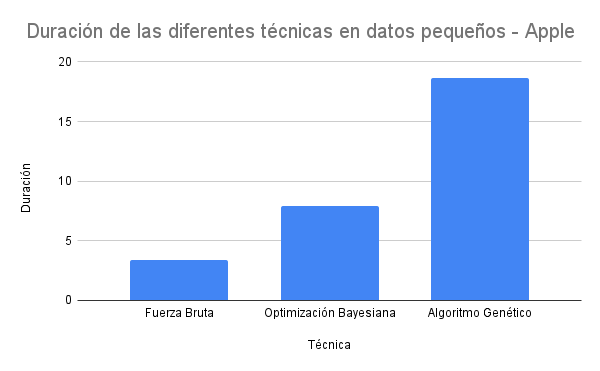
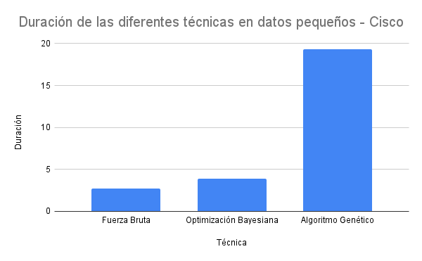

Para el mercado de Microsoft y Nvidia, estos gráfos son similares a los mostrados anteriormente.

## Rendimiento de la técnica

**Análisis**

Para datos pequeños, las predicciones generadas no alcanzan una precisión alta en comparación con los precios reales ya que el modelo no tiene suficientes datos para entrenarse adecuadamente y aprender de los errores y patrones históricos.

Al observar el gráfico de comparación podemos ver que las predicciones generadas por la red neuronal no son tan exactas y presentan ciertas diferencias con los precios históricos. Sin embargo, el margen de error es mejor de lo esperado en comparación a los precios históricos.

Los siguientes gráfico son al usar `Fuerza Bruta`:

Para Apple, obtenemos un margen de error de 2.9007% y una precisión de 91,40%

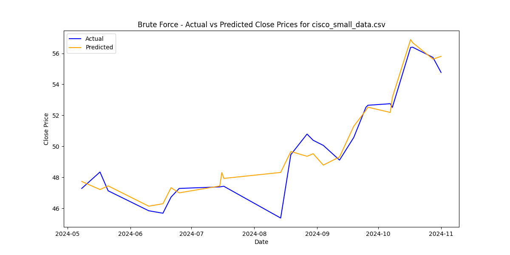

Para Cisco, obtenemos un margen de error de 0.6521% y una precisión de 93.06%

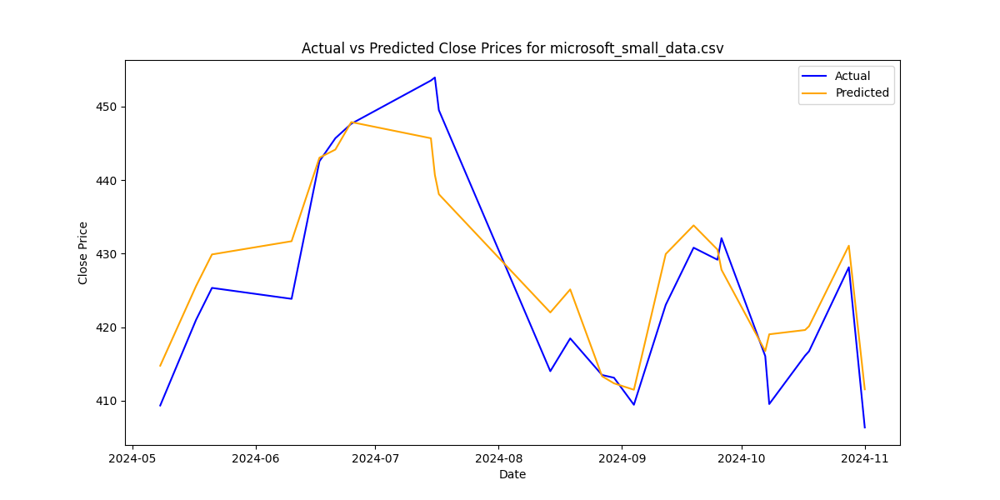

Para Microsoft, obtenemos un margen de error de 4.6251% y una precisión de 84,25%

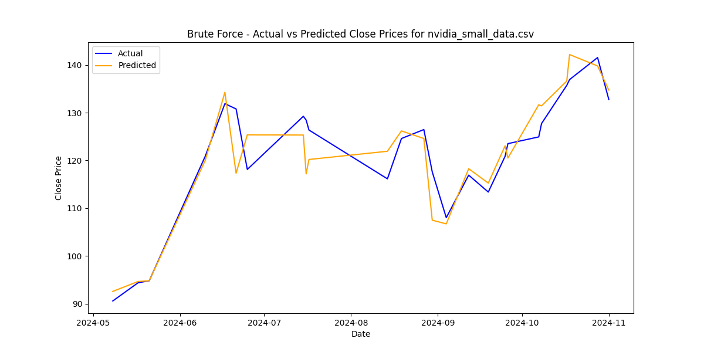

Para Nvidia, obtenemos un margen de error de 3.8812% y una precisión de 83.43%

Usando `Optimización Bayesiana`:

Para Apple, obtenemos un margen de error de 3.13% y una precisión de 91.03%

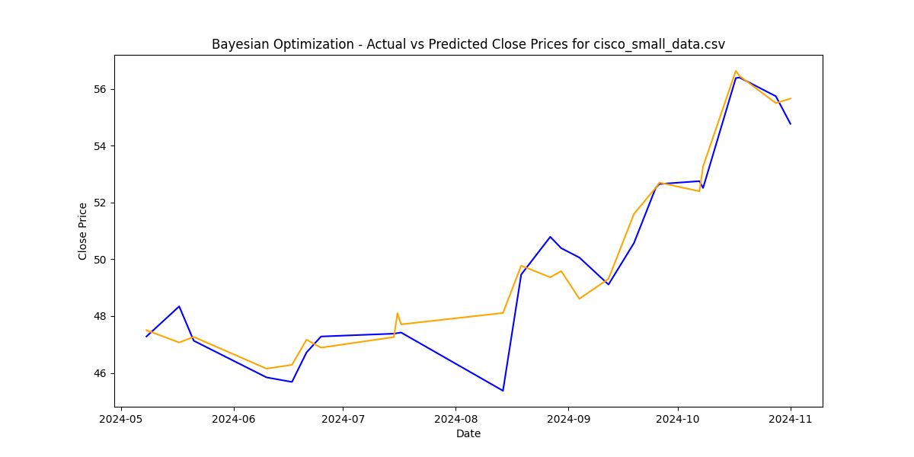

Para Cisco, obtenemos un margen de error de 0.60% y una precisión de 93.53%

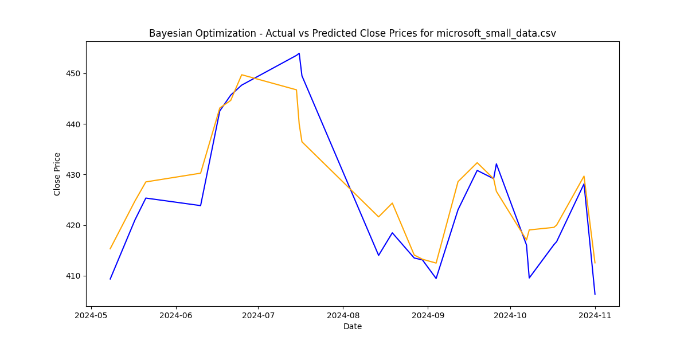

Para Microsoft, obtenemos un margen de error de 4.46% y una precisión de 84.34%

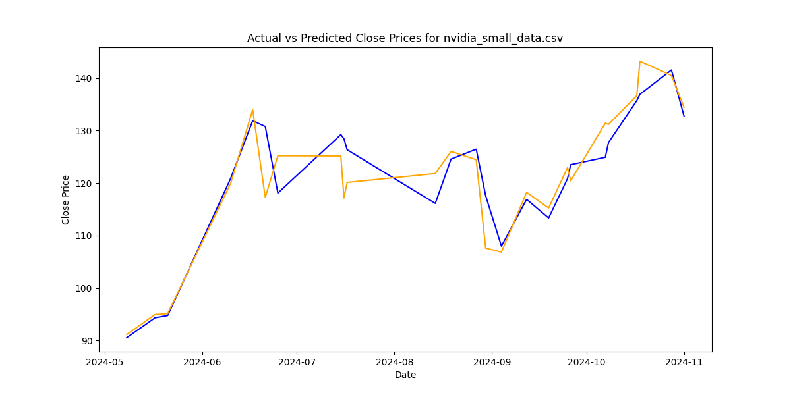

Para Nvidia, obtenemos un margen de error de 3.81% y una precisión de 83.53%

Utilizando optimización bayesiana obtenemos casi que las mismas predicciones que usando fuerza bruta, indicando que ambos algoritmos tienen las mismas capacidades de rendimiento (eficacia de las técnicas). Las técnicas si cumplen con su objetivo de encontrar la mejor configuración de hiperparámetros pero existe la limitación de la pequeña entrada de datos.

Al usar el `algoritmo genético` las predicciones no son lo suficientemente buenas para una inversión. Esto se debe a que los algoritmos genéticos ocupan un espacio de búsqueda muy amplio y se benefician de la mayor cantidad de datos para poder identificar patrones complejos y soluciones óptimas.

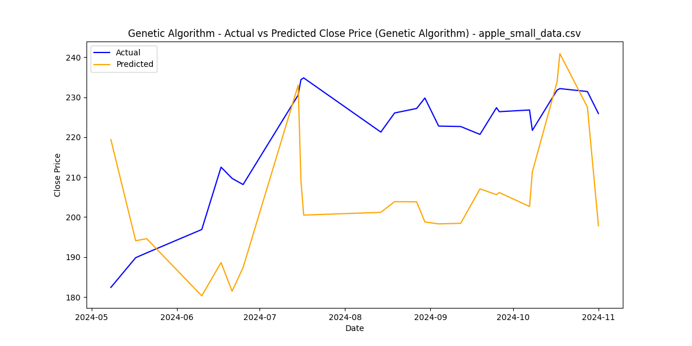

Para Apple, tenemos un margen de error de 18.9858% y una precisión de -116.58%, obteniendo un modelo inexacto y que refleja valores muy alejados de la realidad.

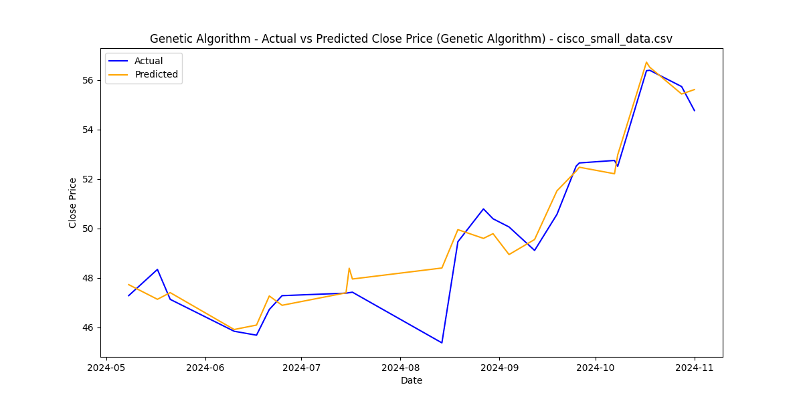

Para Cisco, obtenemos un margen de error de 0.6281% y una precisión de 93.35%

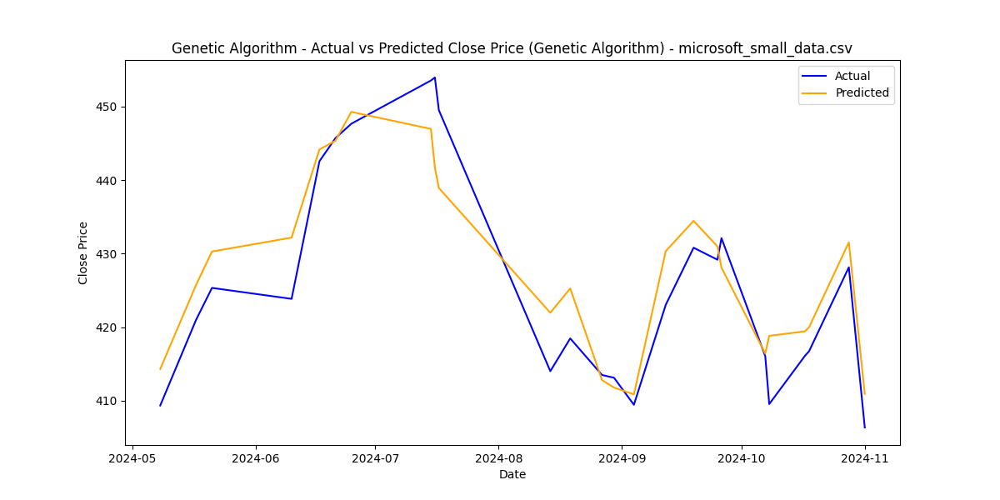

Para Microsoft, obtenemos un margen de error de 4.605% y una precisión de 85.21%

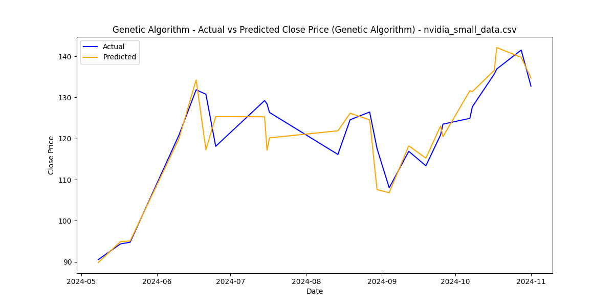

Para Nvidia, obtenemos un margen de error de 3.8446% y una precisión de 83.54%

## Conclusión

Para un conjunto de **datos pequeño**, lo más recomendable es utilizar la técnica `Fuerza Bruta`. Al usarla, se obtienen tiempos de ejecución relativamente pequeños y la mejor precisión de predicción.

## Datos Medianos

Se realizaron 5 corridas y se sacó el promedio de estas.

## Tiempo de ejecución y uso del espacio

### Predicciones de precios actuales en base a datos históricos actuales

| Empresa          | Técnica                | Duración   |
|------------------|------------------------|------------|
| Apple            | Fuerza Bruta           | 17.4947    |
|                  | Optimización Bayesiana | 9.64552    |
|                  | Algoritmo Genético     | 55.7279    |

| Empresa          | Técnica                | Duración   |
|------------------|------------------------|------------|
| Cisco            | Fuerza Bruta           | 11.8832    |
|                  | Optimización Bayesiana | 10.3772    |
|                  | Algoritmo Genético     | 69.0392    |

| Empresa          | Técnica                | Duración   |
|------------------|------------------------|------------|
| Microsoft        | Fuerza Bruta           | 15.872     |
|                  | Optimización Bayesiana | 7.8952     |
|                  | Algoritmo Genético     | 62.953     |

| Empresa          | Técnica                | Duración   |
|------------------|------------------------|------------|
| Nvidia           | Fuerza Bruta           | 9.8456     |
|                  | Optimización Bayesiana | 5.0423     |
|                  | Algoritmo Genético     | 50.2219    |

**Análisis**

La técnica de fuerza bruta muestra tiempos de ejecución razonablemente consistentes, con duraciones en el rango de 9.8 a 17.5 segundos. Aunque esta técnica sigue siendo más lenta que la optimización bayesiana, demuestra un rendimiento estable en datos medianos.

De las tres técnicas, la optimización bayesiana es la más eficiente con tiempos de duración entre 5 y 10.4 segundos. En promedio, esta técnica es más rápida que fuerza bruta y significativamente más rápida que el algoritmo genético. La optimización bayesiana logra un equilibrio entre la búsqueda eficiente y el tiempo de procesamiento, mostrando una escalabilidad favorable y manteniendo buenos tiempos de ejecución al ajustar los hiperparámetros sin una búsqueda exhaustiva.

El Algoritmo Genético tiene los tiempos de ejecución más altos en este conjunto de datos, con duraciones de entre 50 y 69 segundos. La naturaleza estocástica de esta técnica y la cantidad de iteraciones necesarias para converger en una solución adecuada explican su elevado tiempo de procesamiento. Esta técnica es la menos eficiente para datos medianos, ya que el algoritmo genético requiere de múltiples generaciones para refinar las predicciones, lo cual consume más tiempo y recursos.

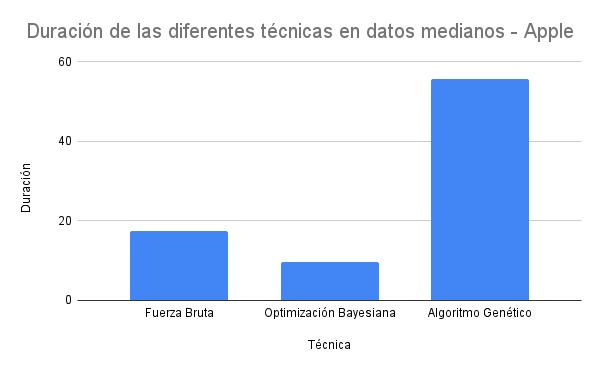
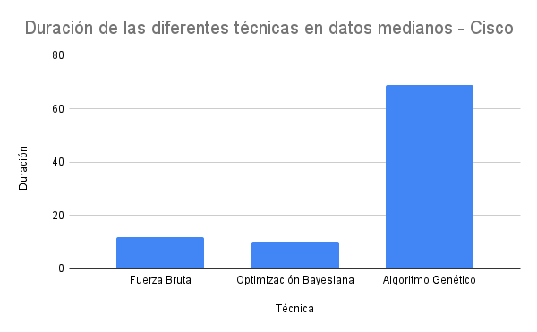

## Rendimiento de la técnica

**Análisis**

Para datos medianos, el modelo de red neuronal resulta ser bastante óptimo en términos de rendimiento ya que logra predecir los precios con bastante exactitud y un margen de error muy pequeño. Esto se debe a la robustidad de la entrada de datos, al tener una buena cantidad de información el modelo puede entrenarse de manera adecuada.

El siguiente gráfico es al usar `Fuerza Bruta`:

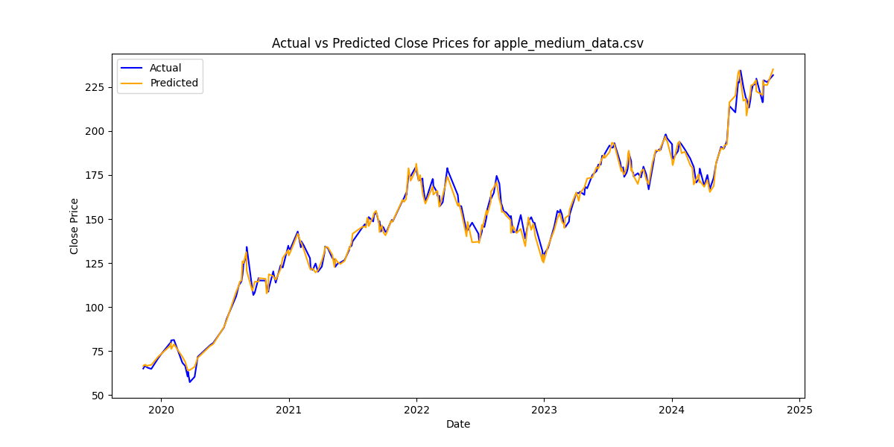

Para Apple, utilizando fuerza bruta obtenemos un margen de error de 2.899% y una precisión de 99.06%.

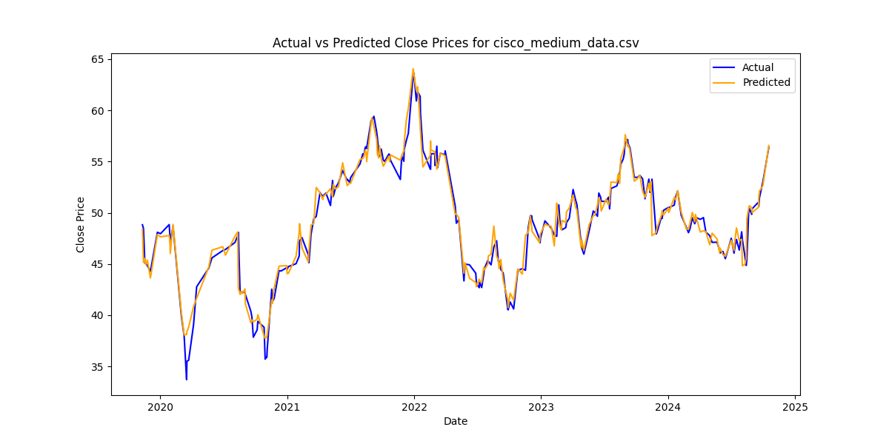

Para Cisco, utilizando fuerza bruta obtenemos un margen de error de 0.7990% y una precisión de 95.61%.

Para Microsoft, utilizando fuerza bruta obtenemos un margen de error de 4.97% y una precisión de 99.25%.

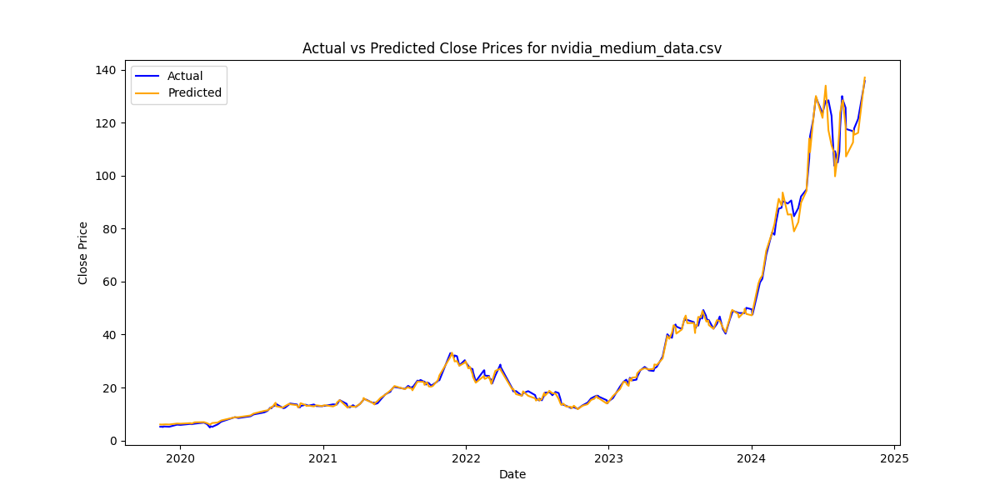

Para Nvidia, utilizando fuerza bruta obtenemos un margen de error de 1.254% y una precisión de 99.56%.

Usando `Optimización Bayesiana`:

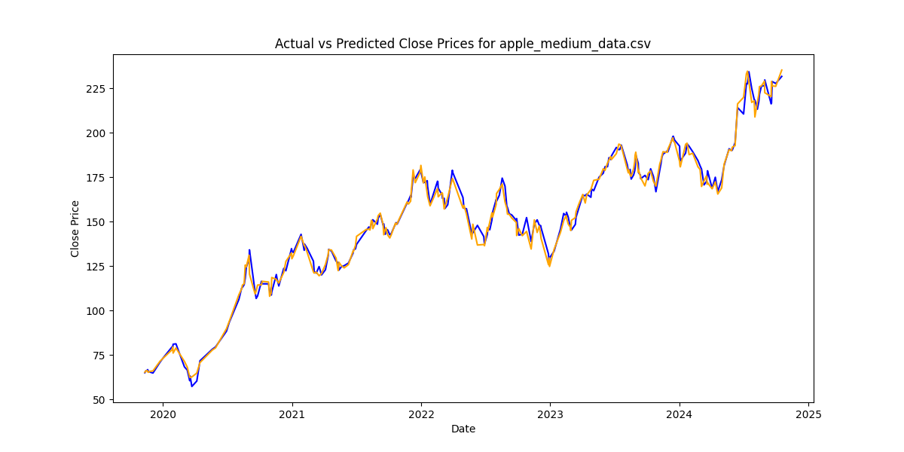

Para Apple, utilizando optimización bayesiana obtenemos un margen de error de 2.86% y una precisión de 99.08%.

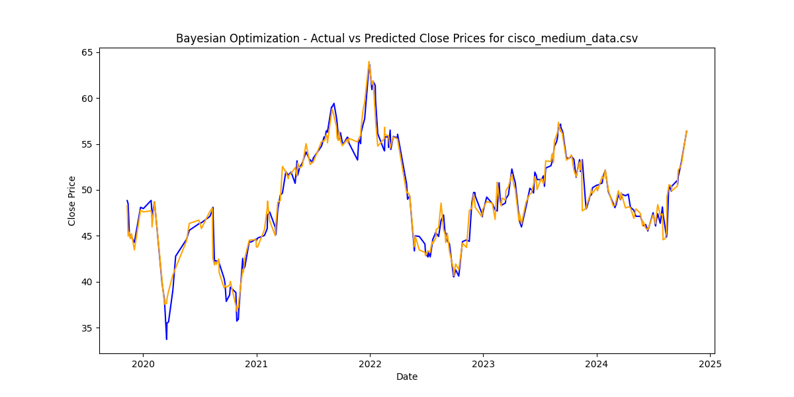

Para Cisco, utilizando optimización bayesiana obtenemos un margen de error de 0.78 y una precisión de 95.76%.

Para Microsoft, utilizando optimización bayesiana obtenemos un margen de error de 4.90% y una precisión de 99.28%.

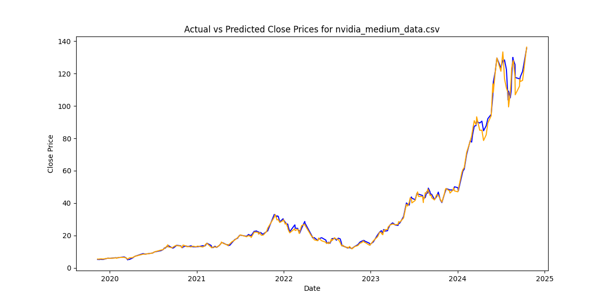

Para Nvidia, utilizando optimización bayesiana obtenemos un margen de error de 1.24% y una precisión de 99.55%.

Usando `Algoritmo Genético`:

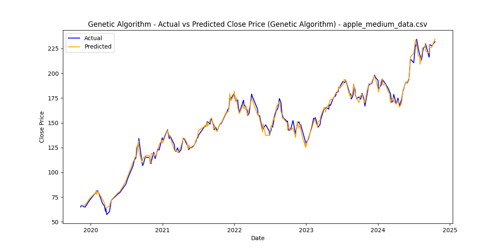

Para Apple, utilizando el algoritmo genético tenemos un margen de error de 2.886% y una precisión de 99.08%.

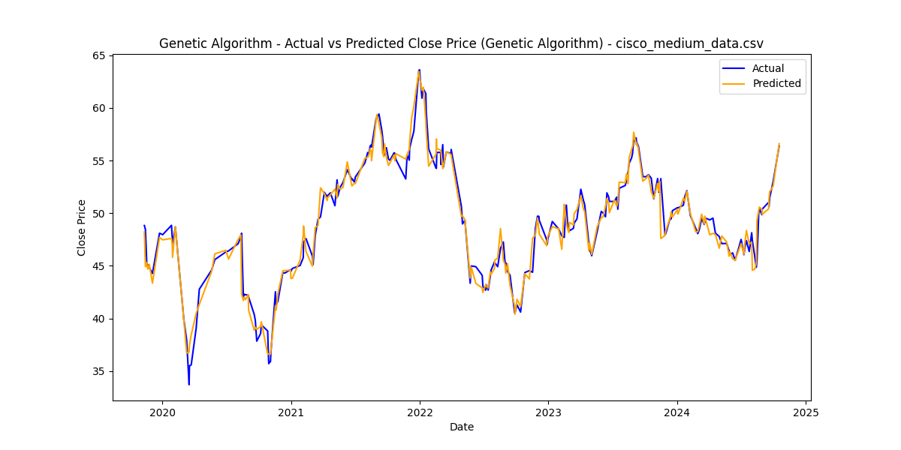

Para Cisco, utilizando el algoritmo genético tenemos un margen de error de 0.7816% y una precisión de 95.81%.

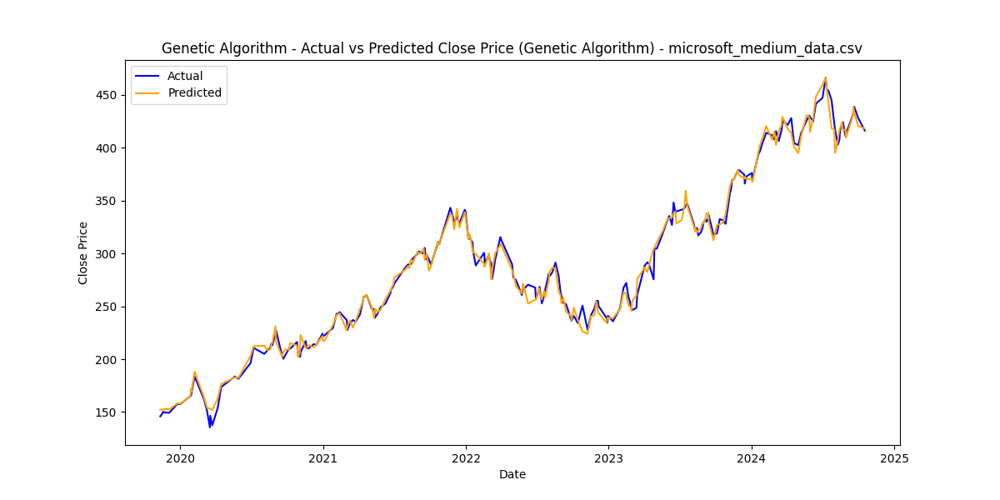

Para Microsoft, utilizando el algoritmo genético tenemos un margen de error de 5.06% y una precisión de 99.23%.

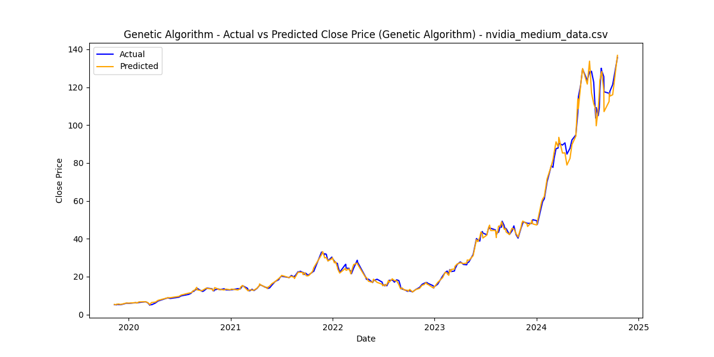

Para Microsoft, utilizando el algoritmo genético tenemos un margen de error de 1.216% y una precisión de 99.56%.

Todas las técnicas muestran un buen rendimiento a la hora de calcular las predicciones. Esto indica la capacidad del modelo de beneficiarse de conjuntos de datos más grandes y mejorar la exactitud de las predicciones.

## Conclusión

Para un conjunto de **datos mediano**, lo más recomendable es utilizar la técnica `Optimización Bayesiana`. Al usarla, se obtienen tiempos de ejecución relativamente pequeños y la mejor precisión de predicción.

## Datos Grandes

Se realizaron 5 corridas y se sacó el promedio de estas.

## Tiempo de ejecución y uso del espacio

### Predicciones de precios actuales en base a datos históricos actuales

| Empresa          | Técnica                | Duración   |
|------------------|------------------------|------------|
| Apple            | Fuerza Bruta           | 21,0475    |
|                  | Optimización Bayesiana | 8,08155    |
|                  | Algoritmo Genético     | 85,3787    |

| Empresa          | Técnica                | Duración   |
|------------------|------------------------|------------|
| Cisco            | Fuerza Bruta           | 18,9856    |
|                  | Optimización Bayesiana | 9,13033    |
|                  | Algoritmo Genético     | 67.2925    |

| Empresa          | Técnica                | Duración   |
|------------------|------------------------|------------|
| Microsoft        | Fuerza Bruta           | 24,1161    |
|                  | Optimización Bayesiana | 7,6788     |
|                  | Algoritmo Genético     | 84,4590    |

| Empresa          | Técnica                | Duración   |
|------------------|------------------------|------------|
| Nvidia           | Fuerza Bruta           | 13,6080    |
|                  | Optimización Bayesiana | 6,0786     |
|                  | Algoritmo Genético     | 57.029     |

**Análisis**

La técnica de fuerza bruta presenta tiempos de ejecución altos en comparación con optimización bayesiana, pero menores que el algoritmo genético. Los tiempos de ejecución están en un rango de 13.6 a 24.1 segundos. La fuerza bruta requiere explorar exhaustivamente las combinaciones posibles, lo que limita su viabilidad en conjuntos de datos grandes debido al tiempo necesario para completar cada corrida.

La optimización bayesiana sigue resultando como la técnica más eficiente en cuanto a tiempo, con tiempos de ejecución entre 6.1 y 9.1 segundos. Este método mantiene un rendimiento estable y rápido incluso con un gran volumen de datos, mostrando su ventaja en la búsqueda eficiente y en la optimización de hiperparámetros sin tener que explorar exhaustivamente cada combinación. Esto hace que la optimización bayesiana sea la opción más adecuada para grandes conjuntos de datos.

El Algoritmo Genético muestra tiempos de ejecución elevados para datos grandes, con tiempos en el rango de 57 a 85 segundos. La técnica requiere muchas generaciones y evaluaciones de individuos, lo que resulta en un tiempo de procesamiento prolongado. Aunque puede explorar un espacio de soluciones amplio, su eficiencia disminuye significativamente cuando se aplican datos grandes, lo cual afecta su idoneidad en aplicaciones donde la velocidad de procesamiento es crítica.

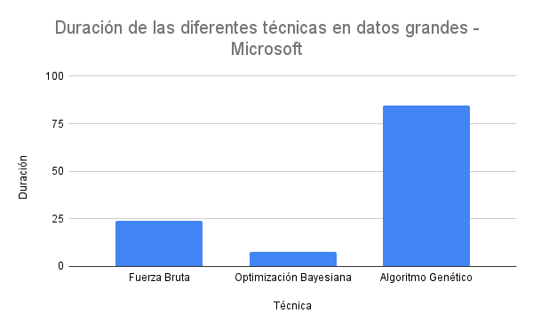
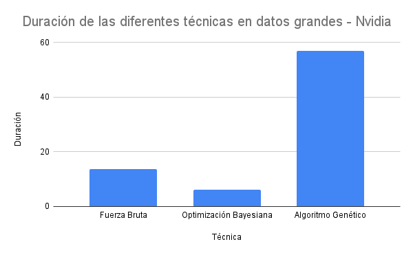

## Rendimiento de la técnica

**Análisis**

Para datos grandes, el modelo de red neuronal alcanza su mejor rendimiento en términos de precisión y capacidad predictiva. Con una gran cantidad de datos históricos, el modelo puede capturar patrones de forma detallada lo que permite generar predicciones con un margen de error muy reducido. Esta mejora se debe a que el modelo, al tener más ejemplos, puede generalizar mejor y adaptarse a las fluctuaciones del mercado reflejadas en los datos.

Al observar los gráficos comparativos, podemos ver que las predicciones se ajustan estrechamente a los valores reales, lo que demuestra que la red neuronal está bien optimizada para realizar estimaciones precisas cuando se dispone de una robusta base de datos.

El siguiente gráfico es al usar `Fuerza Bruta`:

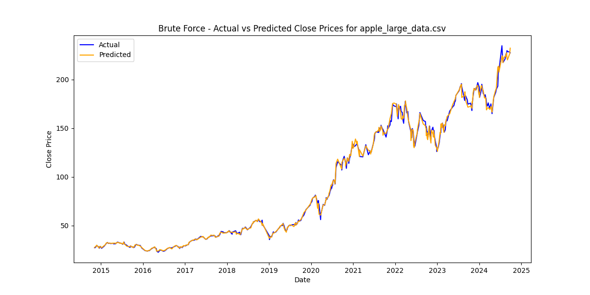

Obtenemos un margen de error de 1.7271% y una precisión de 99,79%

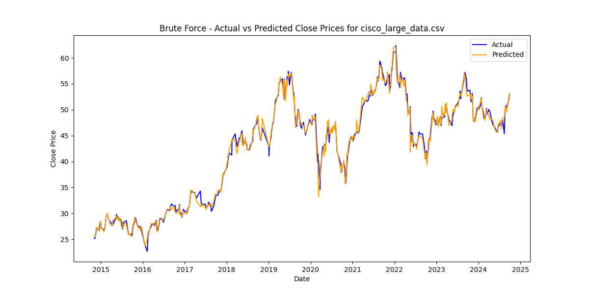

Obtenemos un margen de error de 0.643% y una precisión de 98,91%

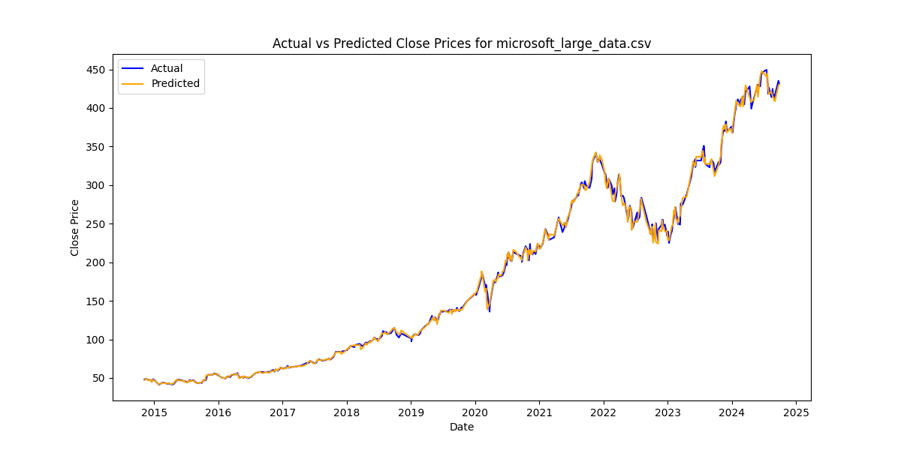

Obtenemos un margen de error de 3.0383% y una precisión de 99,83%

Obtenemos un margen de error de 0.621% y una precisión de 99,65%

Usando `Optimización Bayesiana`:

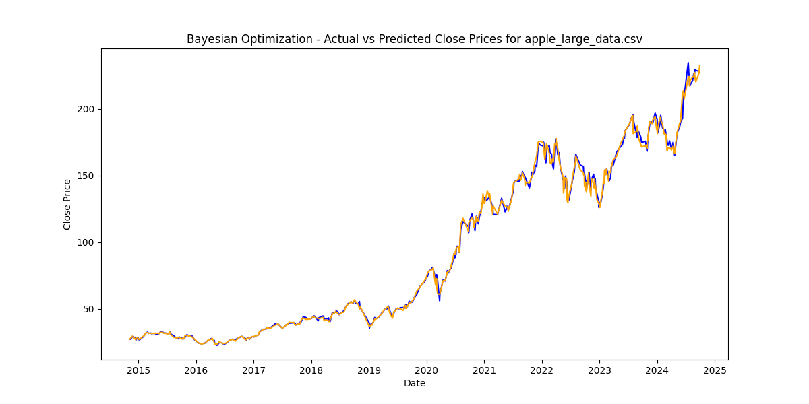

Obtenemos un margen de error de 0.64% y una precisión de 99,66%

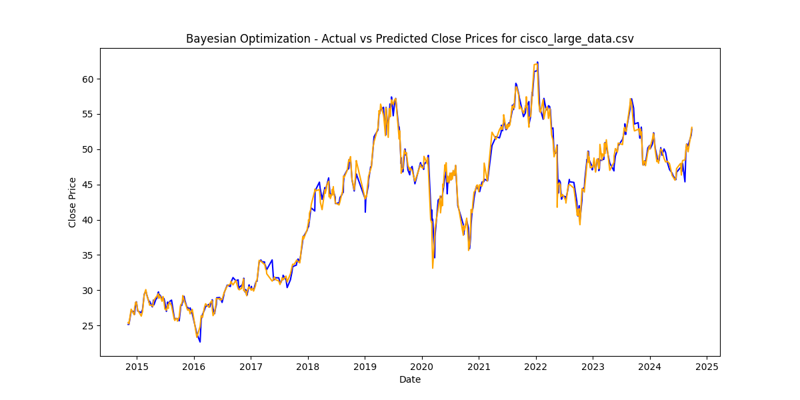

Obtenemos un margen de error de 0.64% y una precisión de 98,90%

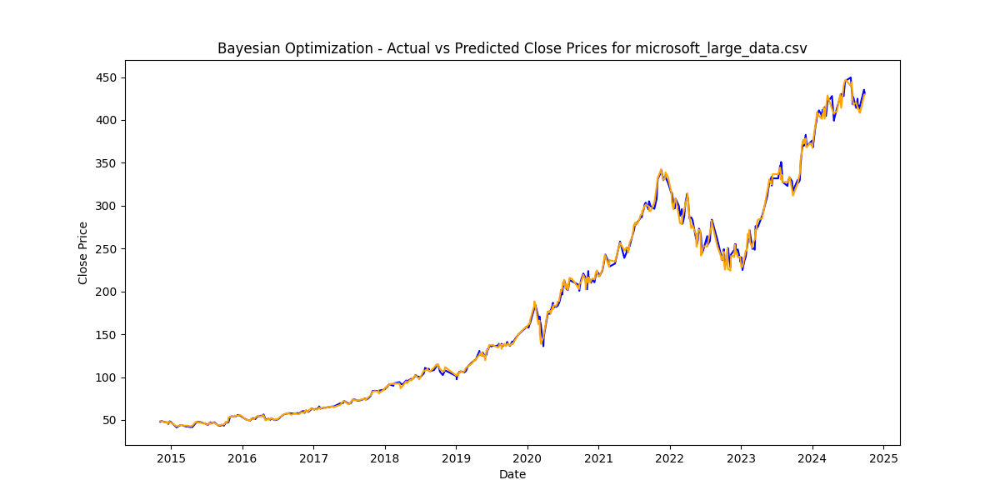

Obtenemos un margen de error de 0.68% y una precisión de 99,79%

Obtenemos un margen de error de 0.64% y una precisión de 99,66%

Usando `Algoritmo Genético`:

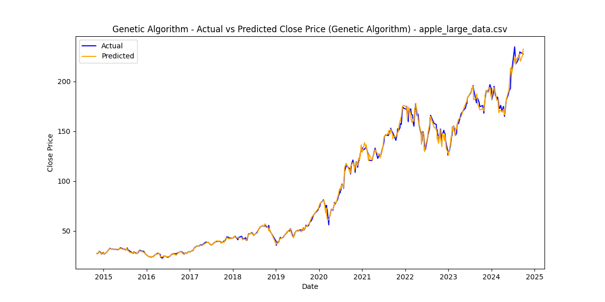

Para Apple, utilizando el algoritmo genético tenemos un margen de error de 1.742% y una precisión de 99,79%

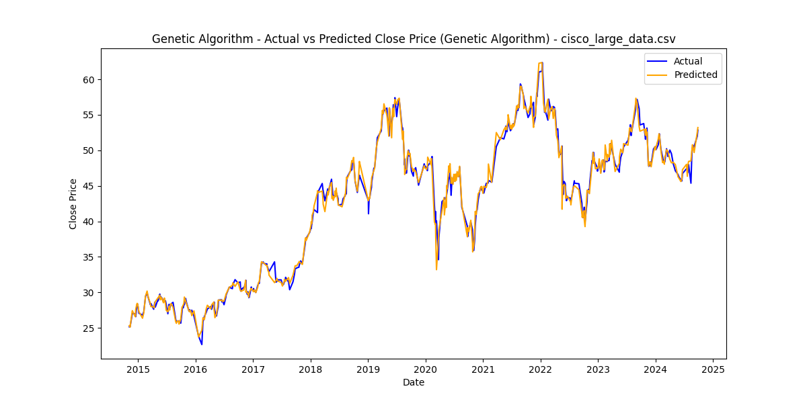

Para Cisco, utilizando el algoritmo genético tenemos un margen de error de 0.643% y una precisión de 98,90%

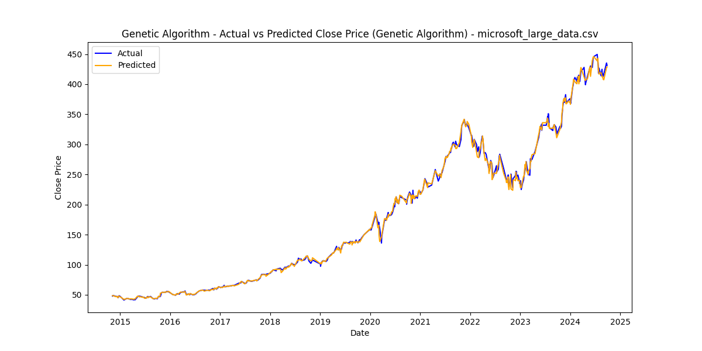

Para Microsoft, utilizando el algoritmo genético tenemos un margen de error de 3.057% y una precisión de 99,83%

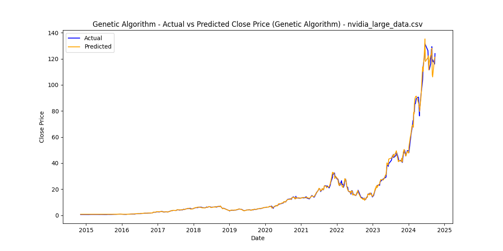

Para Nvidia, utilizando el algoritmo genético tenemos un margen de error de 0.644% y una precisión de 99,65%

De igual forma que en los conjuntos de datos pasados, todas las técnicas muestran un buen rendimiento a la hora de calcular las predicciones. Esto indica la capacidad del modelo de beneficiarse de conjuntos de datos más grandes y mejorar la exactitud de las predicciones.

## Conclusión

Para un conjunto de **datos grande**, lo más recomendable es utilizar la técnica `Optimización Bayesiana`. Al usarla, se obtienen tiempos de ejecución relativamente pequeños y la mejor precisión de predicción.

### Predicciones de precios futuros en base a datos históricos actuales

Únicamente se realizó con datos grandes para tener una buena aproximación de los precios futuros.

Para la empresa `Apple`, el siguiente gráfico es generado al usar `Fuerza Bruta`:

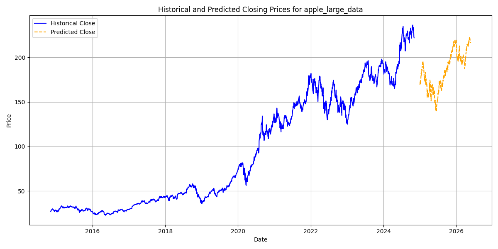

Usando `Optimización Bayesiana`:

Usando `Algoritmo Genético`:

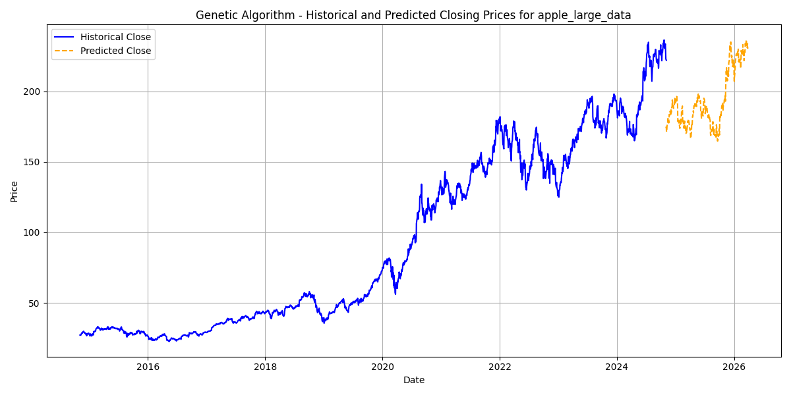

Para la empresa `Cisco`, el siguiente gráfico es generado al usar `Fuerza Bruta`:

Usando `Optimización Bayesiana`:

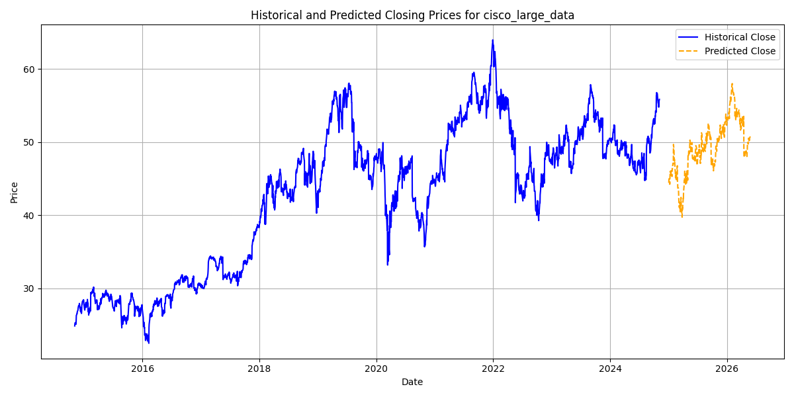

Usando `Algoritmo Genético`:

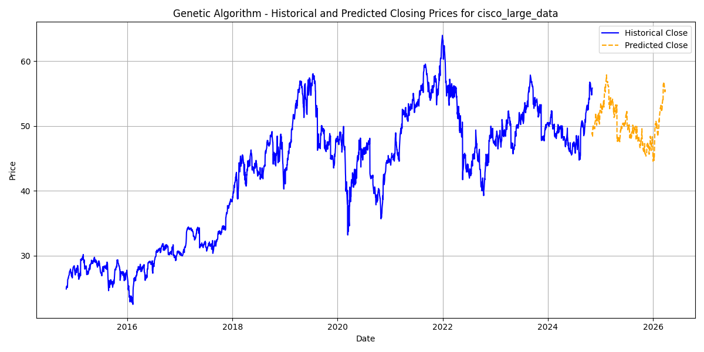

Para la empresa `Microsoft`, el siguiente gráfico es generado al usar `Fuerza Bruta`:

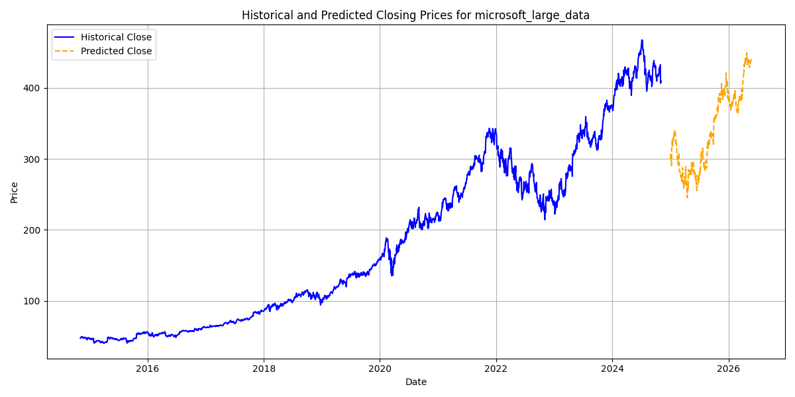

Usando `Optimización Bayesiana`:

Usando `Algoritmo Genético`:

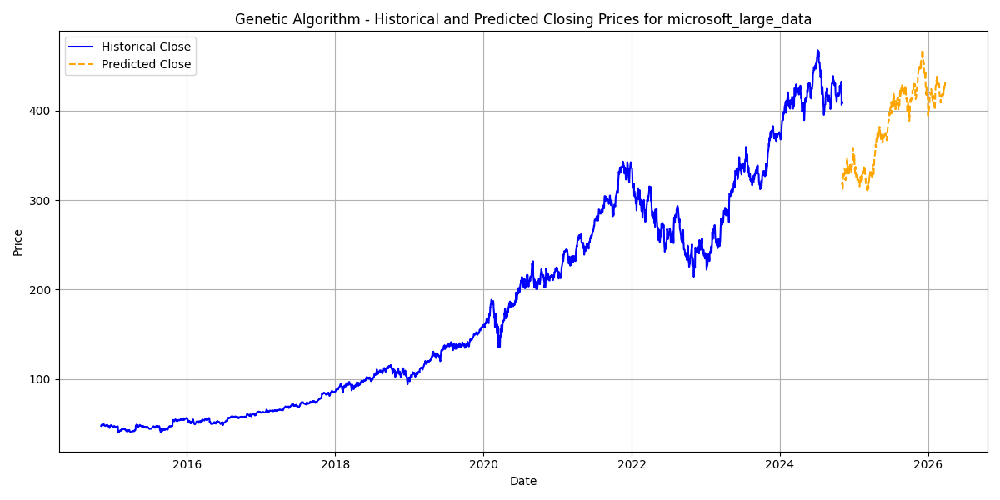

Para la empresa `Nvidia`, el siguiente gráfico es generado al usar `Fuerza Bruta`:

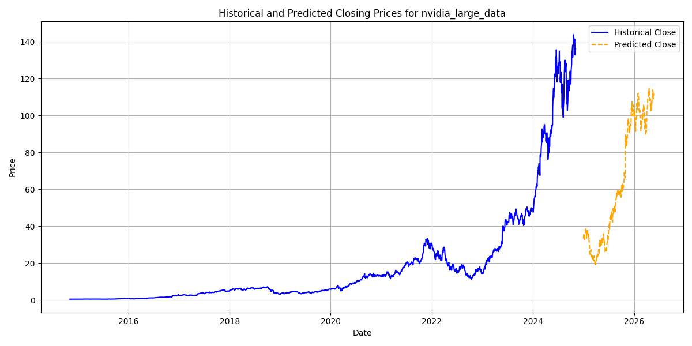

Usando `Optimización Bayesiana`:

Usando `Algoritmo Genético`:

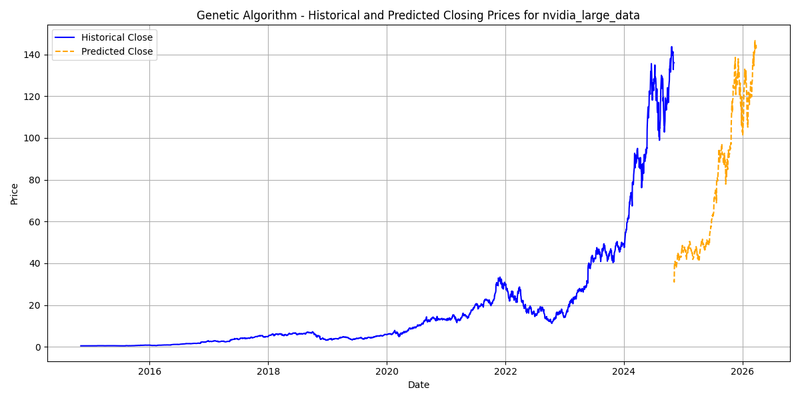

Las predicciones realizadas para cada empresa por cada modelo son
bastante similares aunque si poseen sus diferencias. También las predicciones hechas se basan bastante en el mercado de la empresa del último año.

# Análisis Conclusiones Finales

## Fuerza Bruta

### Tiempo

Al tener que realizar todas las iteraciones con los tres hiperparámetres definidos (x = tamaño capas escondidas, y = tasa de aprendizaje, z = iteraciones máximas), tenemos una complejidad de tiempo de O(x * y * z). No se incluye el tiempo necesario para correr el modelo de la red neuronal.

### Precisión

Al tener que revisar cada combinación, es posible encontrar la mejor configuración, pero su espacio de busqueda se limita el definido.

### Rendimiento

Computacionalmente es caro, más cuando la cantidad de datos son enormes y la cantidad de modelos que debe entrenar.

## Optimización Bayesiana

### Tiempo

Es más eficiente que fuerza bruta ya que no debe probar cada combinación de hiperparámetros.

### Precisión

Dado a que la optimización bayesiana se retroalimenta de evaluaciones pasadas para evaluaciones futuras. Involucra una busqueda inteligente entre explotación y exploración de soluciones, esto le permite buscar más a fondo en áreas prometedoras y no limitarse a números enteros.

### Rendimiento

Al limitarse a busquedas específicas, no realiza busquedas innecesarias el cual guarda recursos. En términos de la forma en que el modelo fue utilizada, al sólo tener 3 hiperparámetros, no se deberieron realizar tantas comparaciones, pero de todas formas si necesita realizar muchas operaciones por cada iteración. En términos de espacio, al utilizar un proceso gaussiano, requiere de espacio para las matrices y estas incrementan con mayor iteraciones.

## Algoritmo Genético

### Tiempo

Este algoritmo es bastante caro computacionalmente, todo dependiendo de la cantidad de hiperparámetros y generaciones que se quieran. Cada solución requiere de entrenamiento, evaluación y va a ver generaciones de esas soluciones.

### Precisión

Con muchas iteraciones, tiene el potencial de tener una precisión bastante acertada por el uso de poblaciones de soluciones y sus evoluciones. Posee un buen balance entre exploración y explotación.

## Razón de duración mayor en el algoritmo genético

Nuestra solución al problema de realizar predicciones futuras no trata de realizar en cada iteración una predicción y comparar a datos pasados del mercado. Lo que pretende hacer es las relaciones entre la información dada cada día por el cierto tiempo definido (tamaño del dataset) y así crear un modelo capaz de realizar predicciones de acuerdo a patrones y relaciones encontradas.

Esto significa que en la fuerza bruta, se realizan evaluacions unitarias sin depender ni informarse de pasadas, por lo que el rango definido de los hiperparámetros no resultan ser tan extraordinarios para tener una duración larga y sus pruebas no són tan pesadas (uso de redes neuronales).

En la optimización bayesiana, al ser una solución probabilistica, esta realiza busquedas inteligentes el cuál permite una convergencia rápida con buenas soluciones y uso de menos iteraciones.

El algoritmo genético realiza también buenas busquedas, pero no son tan inteligentes como la optimización bayesiana, ya que encuentra una zona factible y busca en la zona sin guiarse a un óptimo. Esto significa que debe más iteraciones pero no es lo único, las soluciones que encuentra deben pasar por el proceso de selección, cruce y mutación. Es por eso que la duración es mayor, incluyendo teniendo que hacer utilidad de redes neuronales en cada función *fitness*.
