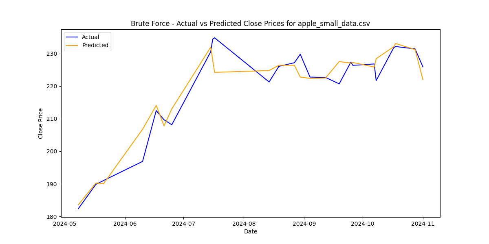
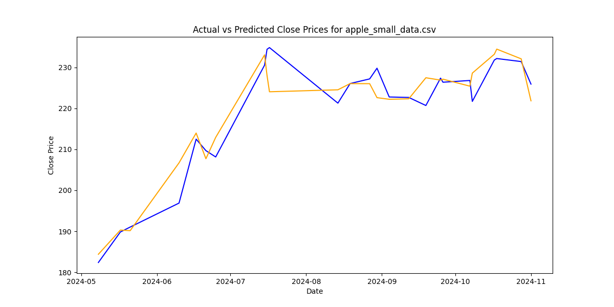
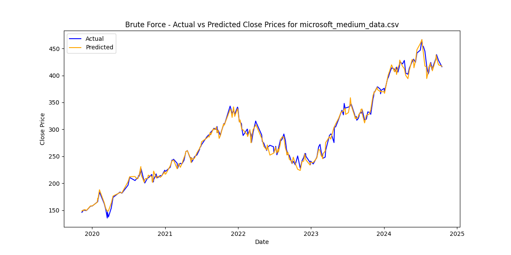
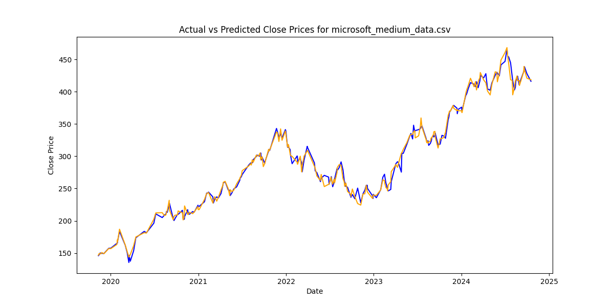
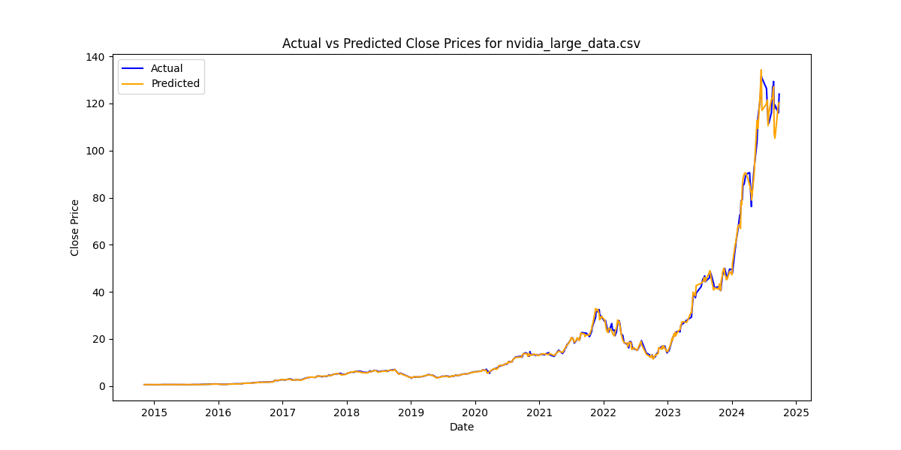
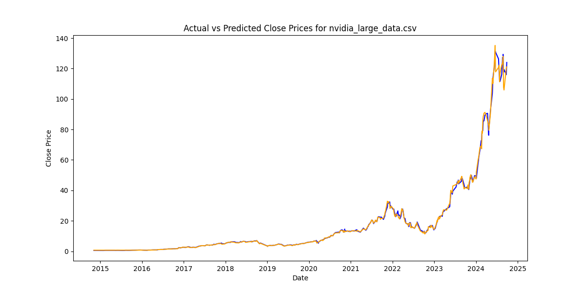

# Comparaciones de rendimiento entre técnicas

## Datos Pequeños

Se realizaron 5 corridas y se sacó el promedio de estas.

## Tiempo de ejecución y uso del espacio

### Predicciones de precios actuales en base a datos históricos actuales

| Empresa          | Técnica                | Duración   |
|------------------|------------------------|------------|
| Apple            | Fuerza Bruta           | 3.3831     |
|                  | Optimización Bayesiana | 7.9235     |
|                  | Algoritmo Genético     |            |

| Empresa          | Técnica                | Duración   |
|------------------|------------------------|------------|
| Cisco            | Fuerza Bruta           | 2.7240     |
|                  | Optimización Bayesiana | 3.8928     |
|                  | Algoritmo Genético     |            |

| Empresa          | Técnica                | Duración   |
|------------------|------------------------|------------|
| Microsoft        | Fuerza Bruta           | 3.7698     |
|                  | Optimización Bayesiana | 7.0763     |
|                  | Algoritmo Genético     |            |

| Empresa          | Técnica                | Duración   |
|------------------|------------------------|------------|
| Nvidia           | Fuerza Bruta           | 3.1424     |
|                  | Optimización Bayesiana | 6.0530     |
|                  | Algoritmo Genético     |            |

**Análisis**

## Rendimiento de la técnica

**Análisis**

Para datos pequeños, las predicciones generadas no alcanzan una precisión alta en comparación con los precios reales ya que el modelo no tiene suficientes datos para entrenarse adecuadamente y aprender de los errores y patrones históricos. 

Al observar el gráfico de comparación podemos ver que las predicciones generadas por la red neuronal no son tan exactas y presentan ciertas diferencias con los precios históricos. Sin embargo, el margen de error es mejor de lo esperado en comparación a los precios históricos.

El siguiente gráfico es al usar `Fuerza Bruta`:

Usando `Optimización Bayesiana`:

Obtenemos casi que las mismas predicciones que usando Fuerza Bruta, indicando que ambos algoritmos tienen las mismas capacidades de rendimiento (eficacia de las técnicas). Las técnicas si cumplen con su objetivo de encontrar la mejor configuración de hiperparámetros pero existe la limitación de la pequeña entrada de datos.

## Datos Medianos

Se realizaron 5 corridas y se sacó el promedio de estas.

## Tiempo de ejecución y uso del espacio

### Predicciones de precios actuales en base a datos históricos actuales

| Empresa          | Técnica                | Duración   |
|------------------|------------------------|------------|
| Apple            | Fuerza Bruta           | 17.4947    |
|                  | Optimización Bayesiana | 9.64552    |
|                  | Algoritmo Genético     |            |

| Empresa          | Técnica                | Duración   |
|------------------|------------------------|------------|
| Cisco            | Fuerza Bruta           | 11.8832    |
|                  | Optimización Bayesiana | 10.3772    |
|                  | Algoritmo Genético     |            |

| Empresa          | Técnica                | Duración   |
|------------------|------------------------|------------|
| Microsoft        | Fuerza Bruta           | 15.872     |
|                  | Optimización Bayesiana | 7.8952     |
|                  | Algoritmo Genético     |            |

| Empresa          | Técnica                | Duración   |
|------------------|------------------------|------------|
| Nvidia           | Fuerza Bruta           | 9.8456     |
|                  | Optimización Bayesiana | 5.0423     |
|                  | Algoritmo Genético     |            |

## Rendimiento de la técnica

**Análisis**

Para datos medianos, el modelo de red neuronal resulta ser bastante óptimo en términos de rendimiento ya que logra predecir los precios con bastante exactitud y un margen de error muy pequeño. Esto se debe a la robustidad de la entrada de datos, al tener una buena cantidad de información el modelo puede entrenarse de manera adecuada.

El siguiente gráfico es al usar `Fuerza Bruta`:

Usando `Optimización Bayesiana`:

Ambas técnicas muestran un buen rendimiento a la hora de calcular las predicciones. Esto indica la capacidad del modelo de beneficiarse de conjuntos de datos más grandes y mejorar la exactitud de las predicciones.

Se realizaron 5 corridas y se sacó el promedio de estas.

## Datos Grandes

## Tiempo de ejecución y uso del espacio

### Predicciones de precios actuales en base a datos históricos actuales

| Empresa          | Técnica                | Duración   |
|------------------|------------------------|------------|
| Apple            | Fuerza Bruta           | 21,0475    |
|                  | Optimización Bayesiana | 8,08155    |
|                  | Algoritmo Genético     |            |

| Empresa          | Técnica                | Duración   |
|------------------|------------------------|------------|
| Cisco            | Fuerza Bruta           | 18,9856    |
|                  | Optimización Bayesiana | 9,13033    |
|                  | Algoritmo Genético     |            |

| Empresa          | Técnica                | Duración   |
|------------------|------------------------|------------|
| Microsoft        | Fuerza Bruta           | 24,1161    |
|                  | Optimización Bayesiana | 7,6788     |
|                  | Algoritmo Genético     |            |

| Empresa          | Técnica                | Duración   |
|------------------|------------------------|------------|
| Nvidia           | Fuerza Bruta           | 13,6080    |
|                  | Optimización Bayesiana | 6,0786     |
|                  | Algoritmo Genético     |            |

## Rendimiento de la técnica

Para datos grandes, el modelo de red neuronal alcanza su mejor rendimiento en términos de precisión y capacidad predictiva. Con una gran cantidad de datos históricos, el modelo puede capturar patrones de forma detallada lo que permite generar predicciones con un margen de error muy reducido. Esta mejora se debe a que el modelo, al tener más ejemplos, puede generalizar mejor y adaptarse a las fluctuaciones del mercado reflejadas en los datos.

Al observar los gráficos comparativos, podemos ver que las predicciones se ajustan estrechamente a los valores reales, lo que demuestra que la red neuronal está bien optimizada para realizar estimaciones precisas cuando se dispone de una robusta base de datos.

El siguiente gráfico es al usar `Fuerza Bruta`:

Usando `Optimización Bayesiana`:

De igual forma que en los conjuntos de datos datos pasados, ambas técnicas muestran un buen rendimiento a la hora de calcular las predicciones. Esto indica la capacidad del modelo de beneficiarse de conjuntos de datos más grandes y mejorar la exactitud de las predicciones.

### Predicciones de precios futuros en base a datos históricos actuales

Únicamente se realizó con datos grandes para tener una buena aproximación de los precios futuros.
